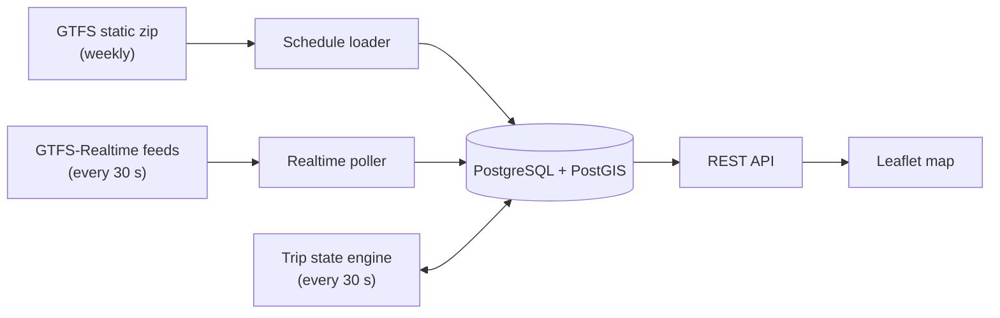

# Ottawa Ghost-Bus Detector

A Java/Spring Boot service that compares OC Transpo's published schedule with its live GTFS-Realtime feed to find **ghost buses**: trips that are on the schedule (and often shown in trip-planner apps) but never actually run.

> **Not affiliated with OC Transpo or the City of Ottawa.** This is an independent personal project that uses OC Transpo's public open data.

**Status:** in development. The schedule database and the static schedule loader are being built now; the realtime poller, trip state engine, REST API and live map come next. See [Roadmap](#roadmap).

---

## What it will do

1. **Load the schedule.** Import OC Transpo's GTFS static zip (routes, stops, trips, stop times, calendars) into PostgreSQL, and work out which trips should run on a given day.
2. **Watch the live feed.** Poll the GTFS-Realtime vehicle-positions and trip-updates feeds every 30 seconds and record what was seen.
3. **Decide each trip's status.** Compare the two and give every trip a status:

   | Status | Meaning |
      |---|---|
   | `SCHEDULED` | On today's schedule; start time hasn't arrived yet |
   | `DUE` | Start time passed, still within the grace period |
   | `TRACKED` | Seen in the live feed |
   | `CANCELLED` | The feed announced the cancellation (not a ghost) |
   | `MISSING` | Grace period passed and still not seen |
   | `GHOST` | Scheduled end time passed and the trip was never seen |
   | `VANISHED` | Was tracked, then disappeared well before the end of the route |
   | `COMPLETED` | Was tracked to (or near) the end of the route |

4. **Show it.** A REST API and a live Leaflet map with today's ghost and missing trips, and simple stats such as ghost trips per route.

It also watches the health of the live feed itself: if the feed stops updating, missing data doesn't mean missing buses, so no trip is marked as a ghost during an outage.

## Architecture



The schedule loader is kept in its own package (`gtfs`) with no ghost-bus logic in it, so it can be reused by other projects on the same data (a RAPTOR trip planner is planned next).

## Tech stack

| Area | Choice |
|---|---|
| Language / framework | Java 25, Spring Boot 4.2 |
| Database | PostgreSQL 17 + PostGIS, in Docker |
| Schema migrations | Flyway |
| Data access | `JdbcTemplate` and transactions for bulk loading (JPA, batch inserts and PostgreSQL `COPY` to be compared) |
| CSV parsing | Apache Commons CSV, streamed row by row |
| Realtime feed | MobilityData `gtfs-realtime-bindings` (Protocol Buffers) |
| Tests | JUnit 5, Testcontainers |
| Build / run | Maven wrapper, Docker Compose |

---

## Running it locally

### Prerequisites

- **JDK 25**
- **Docker Desktop**, running (on Windows, with WSL 2)
- The **OC Transpo GTFS static zip**, from the [OC Transpo developers page](https://www.octranspo.com/en/plan-your-trip/travel-tools/developers) or the [Mobility Database (feed mdb-2154)](https://mobilitydatabase.org/feeds/gtfs/mdb-2154). Unzip it into `data/gtfs/GTFSExport/`, so that files like `data/gtfs/GTFSExport/stops.txt` exist.

No local PostgreSQL or global Maven install is needed: the database runs in Docker and the project includes the Maven wrapper.

### 1. Start the database

Every time you start working, from the project root:

```bash
docker compose up -d     # start PostgreSQL in the background
docker compose ps        # the "db" service should show "Up"
```

The database listens on `localhost:15432` (database `ghostbus`, user `ghostbus`). The password comes from the `DB_PASSWORD` environment variable and defaults to `localdevpassword` for local development.

### 2. Run the app

```bash
./mvnw spring-boot:run          # macOS / Linux
.\mvnw.cmd spring-boot:run      # Windows (PowerShell)
```

On startup, Flyway creates or updates the tables. Spring Boot's Docker Compose support also starts the database if it isn't already running. Check that it's up:

```
GET http://localhost:8080/actuator/health   →   {"status":"UP"}
```

### 3. Load the schedule (current development check)

While the loader is being built, it's run from a temporary `main` method in `GtfsScheduleWriter` (in IntelliJ: click the green arrow next to `main`, with the project root as the working directory). It needs the database running (step 1), and the tables created by running the app once (step 2).

It reloads the tables built so far inside one transaction, then prints `Committed` (or `Rolled back: ...`), the time taken and the row counts.

### 4. Run the tests

```bash
./mvnw test          # macOS / Linux
.\mvnw.cmd test      # Windows
```

Integration tests use Testcontainers, which starts its own PostgreSQL container, so Docker must be running.

### Useful commands

| Command | What it does |
|---|---|
| `docker compose up -d` | Start the database in the background |
| `docker compose ps` | Check whether the database is running |
| `docker compose logs db` | Show the database's log output |
| `docker compose exec db psql -U ghostbus -d ghostbus` | Open a SQL prompt inside the database (`\q` to quit) |
| `docker compose stop` | Stop the database; the data is kept |
| `docker compose down` | Stop and remove the container; the data is kept (it lives in a volume) |
| `docker compose down -v` | Stop and **delete all data**. Flyway rebuilds the tables on the next app start |

### Troubleshooting

| Error contains | Cause | Fix |
|---|---|---|
| `Connection to localhost:15432 refused` | The database isn't running | Start Docker Desktop, then `docker compose up -d` |
| `docker: command not found` or a Docker pipe error | Docker Desktop isn't running | Start Docker Desktop and wait until it says it's running |
| `password authentication failed` | `DB_PASSWORD` doesn't match the password the database volume was created with | Use the original password, or `docker compose down -v` to start fresh (deletes data) |
| `relation "..." does not exist` | Flyway hasn't created the tables yet | Run the app once (step 2) |
| `Migration checksum mismatch` | A migration file that already ran was edited | Locally: `docker compose down -v` and restart. Never edit a migration that has run anywhere else; add a new one |
| `FileNotFoundException` for a `.txt` file | The GTFS files aren't in `data/gtfs/GTFSExport/`, or the run's working directory isn't the project root | Unzip the feed there; set the run configuration's working directory to the project root |

---

## Project layout

```
src/main/java/com/hirokombe/ghostbus/
  gtfs/                     Reusable GTFS static loader (no ghost-bus logic)
    GtfsCsvReader.java        Streams a GTFS CSV file row by row (handles a UTF-8 BOM)
    GtfsRow.java              Typed, validated access to one CSV row
    GtfsTime.java             "25:30:00" -> 91800 seconds (times past midnight)
    GtfsScheduleWriter.java   Inserts parsed rows into PostgreSQL
    model/                    One Java record per GTFS file
src/main/resources/
  db/migration/             Flyway migrations (V1 schedule, V2 tracking, V3 indexes)
  application.yaml
docs/
  DATABASE.md               Schema, design decisions and indexes, with diagrams
  NOTES.md                  Findings from the real OC Transpo data, and performance measurements
  MILESTONES.md             Project plan
compose.yaml                PostgreSQL + PostGIS for local development
```

## Design highlights

Details and trade-offs are in [`docs/DATABASE.md`](docs/DATABASE.md).

- **One schedule at a time, replaced in a single transaction.** A failed import rolls back completely, so the previous schedule stays in place instead of leaving a half-loaded one. This was tested by forcing a failure after loading: the deletes and all inserts were undone.
- **Times past midnight stored as seconds.** GTFS times like `25:30:00` (1:30 a.m., but part of the previous day's service) don't fit PostgreSQL's `TIME` type, so they're stored as seconds from the start of the service day.
- **Strict constraints on the schedule, permissive on the live feed.** Bad schedule data fails the import loudly; unexpected live-feed data is stored as-is so no poll is lost.
- **No foreign keys from tracking history into the schedule.** Trip IDs can change with each weekly schedule, so trip statuses copy the few schedule facts they need instead of pointing at rows that will be replaced.

## Measured so far

From [`docs/NOTES.md`](docs/NOTES.md). Local development machine; only numbers actually measured.

| What | Rows | Time |
|---|---|---|
| Parse all of `stop_times.txt` into Java records (no database) | 2,901,867 | ~2.2 s |
| Insert routes one row at a time, a new connection and commit per row | 178 | ~1.7 s (~9.4 ms/row) |
| Insert agency, routes and stops one row at a time inside one transaction | 6,021 | ~3.5 s (~0.59 ms/row) |

Wrapping the load in one transaction made row-by-row inserts about 16 times faster per row. That's still too slow for the 2.9 million `stop_times` rows, so batch inserts and PostgreSQL `COPY` are next to be measured.

## Roadmap

- [x] Setup: Spring Boot, PostgreSQL + PostGIS in Docker, Flyway
- [x] Study the OC Transpo GTFS static data ([`docs/NOTES.md`](docs/NOTES.md))
- [x] Database schema and indexes ([`docs/DATABASE.md`](docs/DATABASE.md))
- [ ] **Static schedule loader** (in progress: parsing done; agency, routes, stops and services load in one transaction)
- [ ] Today's planned service (calendar rules, overnight trips, daylight-saving days)
- [ ] Realtime poller (waiting on OC Transpo API access)
- [ ] Trip state engine
- [ ] REST API
- [ ] Live map
- [ ] CI with GitHub Actions, and deployment

## Data and attribution

Schedule and realtime data: [OC Transpo open data](https://www.octranspo.com/en/plan-your-trip/travel-tools/developers), used under OC Transpo's developer terms. This project isn't affiliated with or endorsed by OC Transpo or the City of Ottawa.