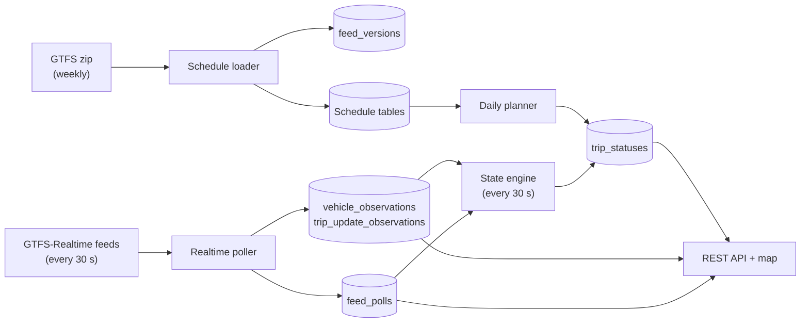
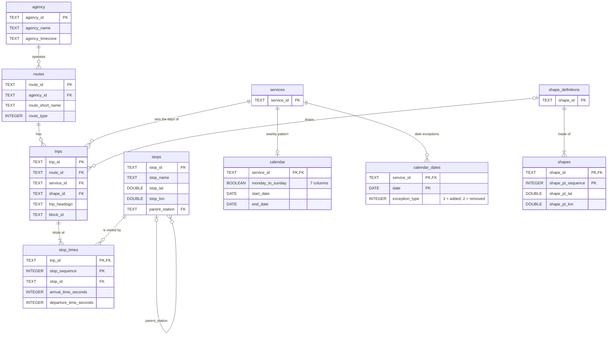
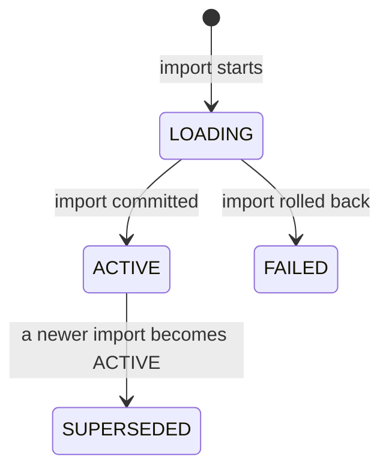
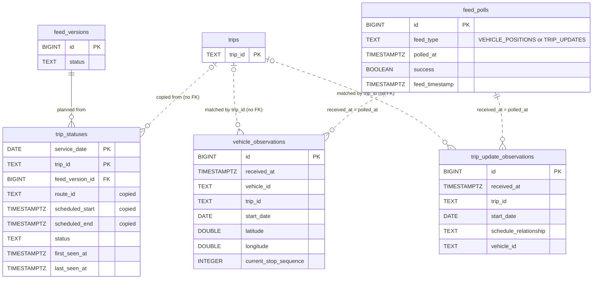

# Database Guide

This document explains how the Ghost-Bus Detector database is organized, why it's designed this way, and how to work with it. The SQL itself lives in `src/main/resources/db/migration/` (V1–V3).

---

## 1. The big picture

The database has two halves:

| Half | Where it comes from | How often it changes | Tables |
|---|---|---|---|
| **Schedule** | OC Transpo's GTFS static zip | Replaced about once a week | `agency`, `routes`, `stops`, `services`, `calendar`, `calendar_dates`, `shape_definitions`, `shapes`, `trips`, `stop_times`, `feed_versions` |
| **Tracking** | OC Transpo's GTFS-Realtime feeds, plus our own conclusions | New rows every 30 seconds | `feed_polls`, `vehicle_observations`, `trip_update_observations`, `trip_statuses` |

The schedule says what **should** run. The tracking tables record what the live feed **said**, and `trip_statuses` records what the app **concluded** (tracked, ghost, cancelled, and so on).

### How data flows through the app

1. The **schedule loader** downloads the zip, records the attempt in `feed_versions`, and replaces the schedule tables.
2. The **daily planner** works out which trips should run on a date and creates one `trip_statuses` row per trip, starting as `SCHEDULED`.
3. The **realtime poller** fetches both live feeds every 30 seconds, logs each attempt in `feed_polls`, and stores what it saw in the observation tables.
4. The **state engine** reads new observations and feed health, then updates each trip's status.
5. The **API and map** read from `trip_statuses`, the observations, and `feed_polls`.

---

## 2. Schedule tables

Each schedule table mirrors one GTFS file and keeps that file's name (`stop_times.txt` → `stop_times`). Two tables, `services` and `shape_definitions`, are our own additions (explained below).

**Reading the diagram:** `||` means "exactly one", `o|` means "zero or one", `o{` means "zero or more", `|{` means "one or more". Solid lines are real foreign keys.

### What each table is for

| Table | Purpose |
|---|---|
| `feed_versions` | Every import attempt, and which schedule is currently loaded (`ACTIVE`). |
| `agency` | The transit agencies in the feed. |
| `routes` | Bus and train routes, e.g. route 11. |
| `stops` | Stops and stations with their coordinates. |
| `services` | Every `service_id` from both calendar files (see below). |
| `calendar` | Which weekdays a service runs, between which dates. |
| `calendar_dates` | Single-date exceptions: service added (1) or removed (2), e.g. holidays. |
| `shape_definitions` | Every `shape_id` (see below). |
| `shapes` | Ordered GPS points that draw a route's path on a map. |
| `trips` | One scheduled run of a route, e.g. the 11 to Lincoln Fields at 22:48. |
| `stop_times` | Each stop a trip makes, in order, with scheduled times. The largest table (about 2.9 million rows). |

### Why `services` and `shape_definitions` exist

GTFS doesn't have a file that lists every `service_id`. A service can appear in `calendar.txt`, in `calendar_dates.txt`, or in both. To give `trips.service_id` a foreign key, it needs one table that holds every service. The loader builds `services` from the union of both calendar files.

`shape_definitions` exists for the same reason: `shapes.txt` has many rows per `shape_id`, so there's no single row for `trips.shape_id` to point at.

### How times are stored

GTFS times can go past midnight. `25:30:00` means 1:30 a.m. the next morning, but the trip still belongs to the previous day's service. Postgres's `TIME` type can't hold a value above 24:00, so `stop_times` stores **integer seconds** instead:

| GTFS time | Stored value |
|---|---|
| `08:00:00` | 28800 |
| `23:35:00` | 84900 |
| `25:30:00` | 91800 |

The seconds count from "noon minus 12 hours" on the service day. That equals midnight on every day except the two days a year when the clocks change for daylight saving time. Converting to a real timestamp therefore has to start from noon on the service day in `America/Toronto` time and subtract 12 hours.

### The `feed_versions` lifecycle

- A unique partial index (`feed_versions_one_active`) guarantees that **at most one** row is `ACTIVE`.
- `zip_sha256` is a fingerprint of the downloaded zip. If it matches the active version's hash, the zip hasn't changed and the import can be skipped.
- The `LOADING` row must be inserted **in its own transaction, before** the import transaction starts. If it were inside the import transaction, a failed import would roll it back too, and the failure would leave no record.

---

## 3. Tracking tables

**Dotted lines are links by value only, with no foreign key.** The app joins on these columns, but the database doesn't enforce them. Section 4 explains why.

### What each table is for

| Table | Purpose |
|---|---|
| `feed_polls` | Every attempt to fetch a live feed, including failures. Used to tell whether the feed is healthy, stale, or down. |
| `vehicle_observations` | One row per vehicle per poll: where each bus was and which trip it said it was running. |
| `trip_update_observations` | One row per trip per poll from the trip-updates feed. Cancelled trips show up here (`schedule_relationship = 'CANCELED'`). |
| `trip_statuses` | The app's conclusion for every planned trip on every service day. One row per `(service_date, trip_id)`. |

### Three different timestamps

| Column | Meaning |
|---|---|
| `feed_polls.polled_at` / `received_at` | When **we** fetched the feed. Every row from one poll shares the same `received_at`. |
| `feed_polls.feed_timestamp` | When **OC Transpo** built the feed (from the feed header). |
| `vehicle_timestamp` / `update_timestamp` | When the **individual vehicle or trip** was last updated. |

A **stale feed** is one where `polled_at` keeps moving (the requests are succeeding) but `feed_timestamp` stops changing (the data inside isn't updating). While the feed is stale or down, the state engine must not mark trips as `GHOST` or `VANISHED`, because missing data doesn't mean missing buses.

### `start_date` is the service day

A trip running at 1:30 a.m. Monday may belong to **Sunday's** service. The feed's `start_date` says which service day a trip belongs to. That's how an observation gets matched to the right `trip_statuses` row, whose key is `(service_date, trip_id)`.

### Trip statuses

| Status | Meaning |
|---|---|
| `SCHEDULED` | On today's schedule; start time hasn't arrived yet. |
| `DUE` | Start time passed, still within the grace period. |
| `TRACKED` | Seen in the live feed. |
| `CANCELLED` | The feed explicitly marked it cancelled. This is announced, so it's **not** a ghost. |
| `MISSING` | Grace period passed and still not seen. It might still show up. |
| `GHOST` | Scheduled end time passed and the trip was never seen. |
| `VANISHED` | Was tracked, then disappeared well before the end of the route. |
| `COMPLETED` | Was tracked through to (or near) the end of the route. |

`current_stop_sequence` (from the latest observation) compared with `last_stop_sequence` (copied from the schedule) gives a simple way to tell `COMPLETED` from `VANISHED` without location math.

---

## 4. Design decisions

### 4.1 One schedule at a time, with no foreign keys from tracking into the schedule

**Decision:** the schedule tables hold only the current schedule, and each import replaces them completely. `trip_statuses` **copies** the few schedule facts it needs (route, headsign, scheduled start and end, last stop sequence) instead of pointing at `trips`.

**Why:** OC Transpo publishes a new schedule about weekly, and `trip_id`s can change between versions. If `trip_statuses.trip_id` had a foreign key to `trips`:
- Postgres would refuse to delete the old trips during a re-import, because history rows point at them.
- The obvious workaround, `TRUNCATE trips CASCADE`, would silently delete all of the status history.

**Alternatives considered:**

| Option | Pros | Cons |
|---|---|---|
| Keep every schedule version side by side (`feed_version_id` in every schedule key) | Full history; any old row can be joined to its exact schedule | Every key and join becomes composite; storage grows weekly |
| Keep one schedule, no copying | Simplest | Old status rows lose their route and times once the schedule is replaced |
| **Keep one schedule, copy what `trip_statuses` needs (chosen)** | Simple schedule tables; history stays meaningful | A little duplicated data |

Copying also speeds up the state engine: it reads a trip's start and end times straight from `trip_statuses` every 30 seconds, instead of computing them from 2.9 million `stop_times` rows.

### 4.2 Strict constraints on the schedule, permissive on the live feed

| | Schedule tables | Raw feed tables |
|---|---|---|
| Foreign keys | Yes | None into the schedule |
| `CHECK` constraints | Strict | None on feed values |
| What happens on bad data | The whole import rolls back | The row is stored as-is |
| Why that's safe | Last week's schedule stays loaded, and we get a loud error | A poll is never lost; odd values can be studied later |

The live feed can mention trips the loaded schedule doesn't know about: a schedule published before we re-imported it, an added trip, or an ID format difference. With a foreign key, that one row would fail, and with a batch insert in a single transaction, the whole poll would be lost. Unknown `trip_id`s are also useful data to count.

`trip_statuses` is strict again (its `status` has a `CHECK`), because only our own code writes to it.

### 4.3 Other choices

| Choice | Reason |
|---|---|
| IDs are `TEXT` | GTFS defines IDs as strings, even when they look like numbers. |
| Real moments in time are `TIMESTAMPTZ` | Stores an exact instant and avoids time-zone bugs. Plain `TIMESTAMP` doesn't record which zone it's in. |
| `status` is `TEXT` with a `CHECK`, not a Postgres `ENUM` | Adding a value later is a simple migration; changing an `ENUM` is more awkward. |
| `stops.parent_station` is `DEFERRABLE INITIALLY DEFERRED` | It's checked at commit instead of row by row, so a stop listed before its parent station in `stops.txt` doesn't fail the import. |
| No `DEFAULT` on route colours | A batch insert lists every column, so a default would never apply. The loader or the UI picks fallbacks. |
| `trip_statuses` key is `(service_date, trip_id)`, date first | Almost every query asks for "trips on date X", and a composite key can be searched by its first column alone. |

---

## 5. Indexes

**How to think about indexes:** an index is a sorted copy of some columns that lets Postgres jump to matching rows instead of reading the whole table. Each one costs disk space and slows down inserts, so every index should serve a real query.

**Composite index rule:** an index on `(a, b)` helps queries that filter on `a`, or on `a` and `b`, but **not** queries on `b` alone. Put equality filters first, then range or sort columns.

### Indexes we have

| Index | Query it serves |
|---|---|
| `trips (service_id)` | "Which trips run under the service_ids active on date X?" (the daily planner) |
| `feed_polls (feed_type, polled_at)` | "What were the last few polls of this feed, and has `feed_timestamp` moved?" (feed health). `feed_type` is an equality filter, so it comes first. |
| `vehicle_observations (received_at)` | Three uses, all filtering on recent time: the state engine ("what arrived since my last run?"), the live-vehicles API ("all rows from the latest poll"), and the retention cleanup ("delete rows older than N days"). |
| `trip_update_observations (received_at)` | The same three uses, for trip updates. |
| `feed_versions_one_active` (unique, partial) | Not for speed. It enforces the "at most one ACTIVE schedule" rule. |

### Queries already covered by primary keys

| Query | Covered by |
|---|---|
| First departure and last arrival for each trip | `stop_times` PK `(trip_id, stop_sequence)` |
| Today's trips that aren't finished | `trip_statuses` PK `(service_date, trip_id)` |
| Find the status row for an observation (`start_date`, `trip_id`) | `trip_statuses` PK |
| API: trips by date, route, and status | `trip_statuses` PK narrows to one day (a few thousand rows); filtering those is cheap |

### Indexes deliberately **not** added

| Index | Why not |
|---|---|
| `calendar_dates (date)` | The table has about 50 rows. Postgres reads a table that small from top to bottom faster than it could use an index, so the index would never be used. |
| `stop_times (stop_id, departure_time_seconds)` | Serves "next departures at a stop", which this app never asks. On 2.9 million rows it would slow every import. Add it when a feature needs it. |
| `trip_statuses (service_date, status)` | The primary key already narrows to one day; a second index adds little. |
| `vehicle_observations (vehicle_id, ...)` | The live-vehicles API reads the latest poll by time, not by vehicle. |
| `vehicle_observations (trip_id, ...)` | The state engine processes new rows by time, not one trip at a time. |

---

## 6. Working with migrations (Flyway)

Flyway runs the numbered files in `db/migration/` in order and records each one, with a checksum (a fingerprint of the file), in the `flyway_schema_history` table.

| Situation | What to do |
|---|---|
| Changing a migration that has only run on your **local** database | Edit it, run `docker compose down -v` (deletes the local database volume), and restart the app. |
| Changing the schema after a migration has run on a database you can't wipe (the deployed app, a teammate's DB) | **Never edit the old file.** Add a new one, e.g. `V4__add_retention_column.sql`. |
| App fails with "Migration checksum mismatch" | A file that already ran was edited. Locally: `docker compose down -v`. Elsewhere: revert the edit and add a new migration instead. |

`spring.jpa.hibernate.ddl-auto` is set to `validate`, so Hibernate only checks that entity classes match the tables. Flyway is the only thing that changes the schema.

### Load and delete order for the schedule

Foreign keys mean parents must exist before children. Insert in this order, and delete in reverse:

`agency` → `routes` → `stops` → `services` → `calendar`, `calendar_dates` → `shape_definitions` → `shapes` → `trips` → `stop_times`

---

## 7. Open questions

These are still unverified and may need new migrations later:

- **Live `trip_id`s:** do they match `trips.txt` exactly? This is unconfirmed until we have API access.
- **Cancellations:** what does a cancelled trip look like in OC Transpo's trip-updates feed?
- **`start_date`:** does the feed always include it?
- **`agency_id`:** if `agency.txt` leaves it empty, the loader must fill in the same value in `agency` and `routes`.
- **`route_type`:** confirm every value in `routes.txt` is in the `CHECK` list.
- **Retention:** how long to keep observation rows. Volume is roughly (vehicles in service × 2,880 polls per day) rows per day for each feed.
- **Foreign-key cost on `stop_times`:** to be measured when the bulk loader is built.
- **Import locking:** replacing the schedule inside one transaction may block readers until it commits. Check whether that matters in practice.

---

## 8. Glossary

| Term | Meaning |
|---|---|
| **GTFS** | Standard zip of text files describing routes, stops, and timetables. |
| **GTFS-Realtime** | Standard live feed (Protocol Buffers format) with vehicle positions and trip updates. |
| **Service day** | The day a trip belongs to. It can run past midnight. |
| **Primary key (PK)** | Column(s) that uniquely identify a row. Postgres indexes them automatically. |
| **Foreign key (FK)** | A column that must match a row in another table. |
| **Partial index** | An index that only covers rows matching a `WHERE` condition. |
| **Stale feed** | The feed responds, but its contents stopped updating. |
| **Retention** | How long old rows are kept before being deleted. |
